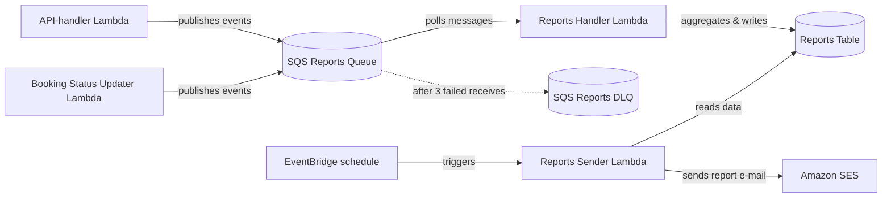

<div align="center">

# ✈️ Travel Agency Application

**A serverless travel-agency platform on AWS — tour discovery, booking management, feedback, documents and automated reporting.**

[](https://bilgeozcan.github.io/travel-agency/)
[](https://scribehow.com/o/jevXPfo4QV2XgKXYrqIBVQ/viewer/Managing_Your_Travel_Agency_Account_And_Bookings__6rFrA5DLR8ub7RWXzFXkpQ)


*EPAM Serverless Project · Run 31 · Team 3 — **ATLAS***

</div>

---

## 📑 Table of contents

- [Overview](#-overview)
- [Live demo & user guide](#-live-demo--user-guide)
- [Features](#-features)
- [Architecture](#-architecture)
- [Tech stack](#-tech-stack)
- [Delivery status](#-delivery-status)
- [Quality & testing](#-quality--testing)
- [Engineering highlights](#-engineering-highlights)
- [AWS cost overview](#-aws-cost-overview)
- [Known limitations & technical debt](#-known-limitations--technical-debt)
- [AI-assisted development](#-ai-assisted-development)
- [Team](#-team)

---

## 🧭 Overview

The **Travel Agency Application** lets customers browse and book tours, travel agents manage those
bookings, and administrators follow business performance through automated reports. The whole backend is
**serverless**: AWS Lambda behind API Gateway, Amazon Cognito for authentication, DynamoDB for storage, and
event-driven components (EventBridge, SQS, SES) for background processing.

The application supports three roles that are assigned automatically at sign-up:

| Role | What they can do |
|------|------------------|
| 🧳 **Customer** | Register, search and view tours, book tours, upload booking documents, leave feedback, manage their profile |
| 🧑‍💼 **Travel Agent** | Review and manage customer bookings (confirm, edit, cancel), see customer details and documents |
| 🛡️ **Admin** | Access reporting (generate / download reports, scheduled report e-mails) |

---

## 🚀 Live demo & user guide

| Resource | Link |
|----------|------|
| 🌐 **Live application** | https://bilgeozcan.github.io/travel-agency/ |
| 📘 **Step-by-step user guide (Scribe)** | [Managing Your Travel Agency Account And Bookings](https://scribehow.com/o/jevXPfo4QV2XgKXYrqIBVQ/viewer/Managing_Your_Travel_Agency_Account_And_Bookings__6rFrA5DLR8ub7RWXzFXkpQ) |

> New here? Start with the **Scribe guide** — it walks through creating an account and managing bookings with
> annotated screenshots.

---

## ✨ Features

### Accounts & security
- **Registration and login** backed by Amazon Cognito (`USER_PASSWORD_AUTH` flow)
- **Automatic role assignment** (Customer / Travel Agent / Admin) with validated authorization rules
- **Profile management**: retrieve/update profile, change password, verified e-mail flow
- **Password recovery**: forgot password → verification code → new password (3-screen reset flow)

### Tours & bookings
- **Tour catalogue** with listing and filtering, plus a detailed tour page
- **Customer booking flow** and dashboard
- **Travel-agent booking management**: confirm a booking, edit a booking (pending approval), cancel with an
  agent reason, automatic transition to `STARTED`, cancellation penalty and document rejection
- **Role-aware dashboard** with booking cards for travel agents

### Documents & feedback
- **Document upload** for customers (upload / update / view / delete) with type-based classification, using
  S3 presigned URLs
- **Customer feedback** with validation, star rating and comments; existing feedback is returned together
  with the booking details

### Reporting
- **Event-driven reports**: booking events are queued, aggregated and stored in a reports table
- **Scheduled report e-mails** sent through Amazon SES
- **Report generation & download** endpoints with PDF / Excel output and date aggregation

---

## 🏗️ Architecture

### Sprint 2 — current components diagram

<p align="center">
  
</p>

**How the pieces fit together**

- **Client → S3 (static hosting)** serves the frontend; **API Gateway** invokes the **API-handler Lambda** for
  all API calls, which validates the Cognito JWT and reads/writes the **DynamoDB** tables
  (Tours, Bookings, Reviews, Feedbacks, Reports, Reports Cache).
- **S3 buckets for Booking Documents and Reports Storage** are accessed by the browser through **presigned URLs**
  generated by the API-handler Lambda.
- A scheduled **Booking Status Updater Lambda** (EventBridge rule `booking-completion-schedule`) updates
  booking states and publishes events.
- **SQS Reports Queue** → **Reports Handler Lambda** aggregates events into the **Reports Table**; messages that
  fail three receives are moved to a **dead-letter queue (DLQ)**.
- A scheduled **Reports Sender Lambda** (EventBridge rule `reports-sender-schedule`) reads report data and sends
  the report e-mail through **Amazon SES**.

### Reporting pipeline



<details>
<summary><b>Sprint 1 baseline architecture</b> (click to expand)</summary>

<p align="center">
  
</p>

Sprint 1 delivered the core: static frontend on S3, API Gateway + API-handler Lambda, Cognito authentication,
DynamoDB tables and a scheduled Booking Status Updater Lambda. Sprint 2 added document storage, feedback,
the event-driven reporting pipeline and account-recovery features on top of this baseline.

</details>

---

## 🧰 Tech stack

| Layer | Technologies |
|-------|--------------|
| **Backend** | Python, AWS Lambda, Amazon API Gateway |
| **Auth** | Amazon Cognito (JWT, `USER_PASSWORD_AUTH`) |
| **Data** | Amazon DynamoDB, Amazon S3 |
| **Async / events** | Amazon EventBridge, Amazon SQS (+ DLQ), Amazon SES |
| **Frontend** | JavaScript web application hosted as a static website on S3 |
| **API contract** | OpenAPI specification (Swagger / Postman) |
| **Testing** | `pytest` (backend), `npm run test` (frontend), manual + automated QA artefacts |

---

## ✅ Delivery status

All user stories planned for Sprints 1 and 2 are **done**.

| Sprint | Story | Title | Type | Status |
|:------:|-------|-------|:----:|:------:|
| 1 | US_1 | User profile registration | Required | ✅ |
| 1 | US_2 | User login | Required | ✅ |
| 1 | US_3 | Automatic role assignment | Required | ✅ |
| 1 | US_4 | Select available tours | Required | ✅ |
| 1 | US_5 | View detailed information on a selected tour | Required | ✅ |
| 1 | US_6 | Tour booking by customer | Required | ✅ |
| 2 | US_8 | Tour booking management by travel agent | Required | ✅ |
| 2 | US_9 | Customer feedback | Required | ✅ |
| 2 | US_10 | Automated reports | Required | ✅ |
| 2 | US_7 | Documents upload by customer | Optional | ✅ |
| 2 | US_11 | Reporting interface | Optional | ✅ |
| 2 | US_12 | Update profile information | Optional | ✅ |
| 2 | US_13 | User password recovery | Optional | ✅ |

---

## 🧪 Quality & testing

| Area | Result |
|------|--------|
| Backend (`pytest`) | **460 passed**, 43 subtests passed |
| Frontend (`npm run test`) | **89 test files / 616 tests passed** |
| Frontend production build | **Passed** |
| OpenAPI specification | Valid JSON, synchronized with the implementation |

Run the checks locally (from the repository root, or the frontend directory for the `npm` commands):

```bash
# Backend
pytest pyapp/tests/test_api_handler -q

# Frontend
npm run test
npm run build
```

**QA artefacts** maintained by the team: Test Plan & Test Strategy, API test-case document, UI test-case
document, automation framework with automated API/UI checks, and an end-to-end validation of the report flow
(US_10 / US_11). Covered flows include document upload, feedback, the booking state machine, profile/security
and password reset.

---

## 🛠️ Engineering highlights

Improvements made in Sprint 2 after the Demo 1 feedback:

1. **Project structure cleaned up** — responsibilities removed from the main `handler.py` and separated into
   business logic, validation, data access and reusable utilities; environment configuration centralized.
2. **Booking logic refactored and consolidated** — duplicated logic removed and the booking lifecycle reduced to
   a clearer, more maintainable flow.
3. **OpenAPI synchronized with the implementation** — latest booking endpoints, request/response models and
   schemas reflected in the specification.
4. **Architecture diagrams corrected** — runtime calls are shown as one-way flows with accurate dashed links.
5. **Delivery evidence made visible** — required vs. optional stories, Jira status and demo evidence are tracked
   explicitly, and the Sprint 1 baseline is separated from the Sprint 2 increment.

---

## 💰 AWS cost overview

Cloud spending stayed very low in the educational sandbox environment: usage was minimal in the early stages
and grew mainly during the final sprint (AWS Config, Amazon GuardDuty, S3, Cognito and other supporting
services), driven by active development, testing, deployment and demo preparation.

<p align="center">
  
</p>

---

## ⚠️ Known limitations & technical debt

Recorded openly so they can be prioritized in future iterations:

| # | Area | Description |
|---|------|-------------|
| 1 | **US_7 — Document upload validation** | Optional story. Backend file-content validation was intentionally deferred from the MVP scope. |
| 2 | **US_10 — Reporting performance** | Validated with seed data; performance may degrade with larger datasets and needs further optimization. |
| 3 | **US_11 — Staff performance report** | Location selection is required only on the frontend to enable the report, although it does not affect backend processing. |
| 4 | **US_13 — Reset-password response delay** | Verification-code send/validate responses are returned only after the full process completes, causing noticeable latency in the sign-in flow. |
| 5 | **US_10 — Reports infrastructure** | The report schedule trigger currently runs daily; it can be changed to weekly in future iterations. |

---

## 🤖 AI-assisted development

The team used **GitHub Copilot**, **ChatGPT** and **Claude** for bug diagnosis, architecture validation,
test and checklist scaffolding, documentation wording and merge-request / commit-message drafting.

> **Rule:** every AI suggestion was manually reviewed before it was committed or integrated.

---

## 👥 Team

**Team 3 — ATLAS** (EPAM Serverless Project, Run 31)

| Member | Role |
|--------|------|
| **Nur Bilge Özcan** | Team Lead · Python Developer — [GitHub](https://github.com/BILGEOZCAN) · [LinkedIn](https://linkedin.com/in/nur-bilge-özcan-123975257) |
| Ahmet Faruk Bilgin | Python Developer |
| Mehtap Korkmaz | Python Developer |
| Yahya Arda Ozdemir | Python Developer |
| Serhat Arslan | Frontend / JavaScript Developer |

**Former contributors:** Furkan Onur (backend authorization tasks in Sprint 1), Tetiana Borys (on leave from the
start of Sprint 2), Nadiya Tsiura (joined in her place for Sprint 2) and Enes Demir (until mid-Sprint 2).
Thank you for your contributions.

---

<div align="center">

Built with ☁️ serverless and ❤️ by **Team ATLAS** · *Demo 2 — 31 August 2026*

</div>
